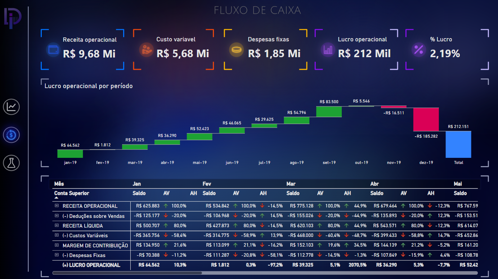
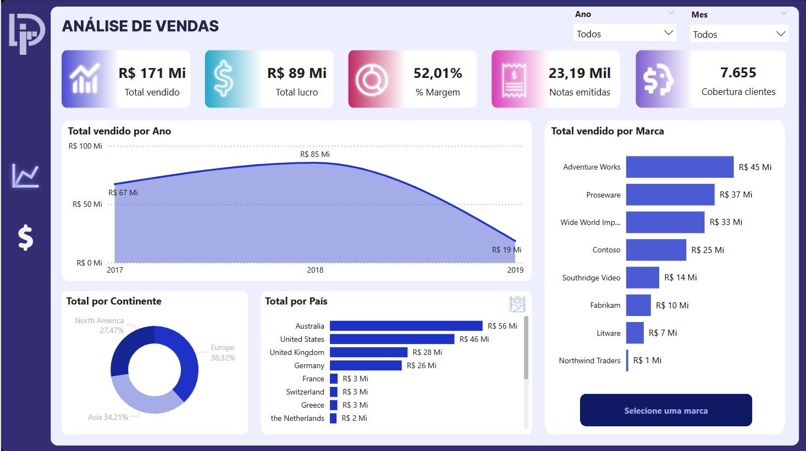
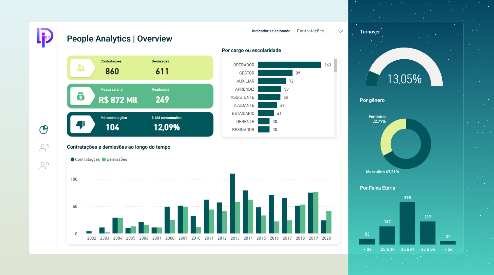
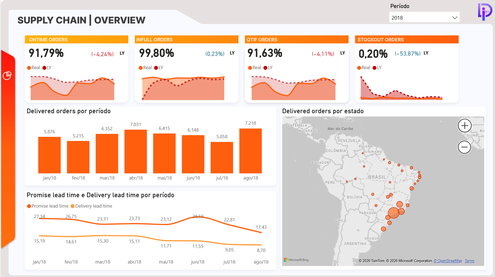

# Portfolio Diogo Silva | Soluções Analíticas para o seu Negócio

<https://www.diogosilvaportfolio.com/>

HOME

EXPERIENCIAS

HABILIDADES

PORTFÓLIO

CONTATO

## BEM VINDO AO MEU PORTFÓLIO!

### DIOGO SILVA

###### ESPECIALISTA EM BUSINESS INTELLIGENCE

### SOBRE MIM

Sou apaixonado por transformar dados em decisões inteligentes. Há mais de 6 anos atuo na área de dados, unindo técnicas e estratégias de BI e análise de dados para gerar valor em cada projeto. Pós graduado em Data analytics pela FIAP, sou especialista em Power BI e SQL, tenho conhecimentos avançados em Python e automação de processos, desenvolvo soluções analíticas que fortalecem a tomada de decisão traduzindo números em insights que impulsionam a eficiência do negócio.

Power BI | Python | SQL | Machine Learning | Analise de dados | Pipelines de dados | Automações | APIs | Airflow | Git/Github

## EXPERIENCIAS

2025 - 2026

2018 - 2025

###### ANALISTA DE DADOS III MARKETING PRIVALIA

###### ANALISTA DE BI III OPERAÇÕES PRIVALIA

Atuação estratégica na área de Marketing Analytics, com foco em análise de dados, automação de processos e desenvolvimento de soluções orientadas a dados. Principais entregas e resultados:

Atuação estratégica na área de dados em operações, com passagem pelos setores de Customer Experience e Supply Chain, sendo responsável por processos de ETL, desenvolvimento de dashboards, análises avançadas e apoio na implementação do projeto de governança de dados. Principais entregas e resultados:

- Desenvolvimento de dashboards gerenciais de churn e marketing share, para acompanhamento de performance;
- Construção e manutenção de pipelines de ETL, garantindo qualidade, disponibilidade e escalabilidade dos dados;
- Aumento de eficiência operacional com desenvolvimentos de automações em Python, com orquestração via Airflow e versionamento via Git;
- Criação de modelo de machine learning para propensão a churn, apoiando estratégias de retenção de clientes;
- Realização de análises de cohort e estudos aprofundados de comportamento do cliente;
- Integração de dados via API do Marketing Cloud, dando visibilidade e acompanhamento de campanhas de CRM
- Apoio na estruturação da governança de dados e suporte contínuo ao time de negócio.

- Desenvolvimento de dashboards gerênciais, utilizados pelas lideranças e diretorias;

- Automatização de processos, reduzindo custos operacionais e aumentando a produtividade das equipes;

- Construção de RPAs (robos) com Python, reduzindo horas de trabalho em processos engessados;

- Integração com APIs de sistemas como TMS, otimizando a gestão e o acompanhamento de transportadoras;

- Condução de treinamentos internos, fortalecendo a cultura de dados e capacitando o time de negócios;

- Construção do dashboard premiado como melhor projeto desenvolvido em 2024, reconhecido pela diretoria e pelo CEO da Privalia.

​

​​​​

Principais ferramentas: Python, SQL, Airflow, Git, Power BI, APIs (Marketing Cloud) e técnicas de Machine Learning.

​Principais ferramentas: Power BI, Excel, SQL, Kettle, Airflow e Python.

## formação, ESPECIALIZAÇÕES e HABILIDADES

###### Formação em Administração de Empresas pela USTJ e pós-graduação em Data Analytics pela FIAP, com foco em análise exploratória, modelagem preditiva e Big Data.
Especialização em Power BI, SQL, Excel e Python, com domínio em processos de ETL, modelagem e arquitetura de dados e Data visualization.
Perfil analítico e orientado a resultados, com forte capacidade de resolver problemas complexos, pensamento crítico e atenção aos detalhes, habilidades que me permitem transformar dados em insights estratégicos e apoiar em decisões de alto impacto.

#### CURSO COMPLETO DE POWER BI

#### Python para Data Science

##### Xperiun | Data analitycs

##### Alura

###### Jan 2022

###### Dez 2024

+ Power BI

+ ETL

+ DAX

+ ETL

+ Python

+ Analise de dados

#### Apache Airflow

#### PÓSTECH DATA ANALYTICS

##### Alura

##### FIAP

###### Dez 2024

###### Jan 2026

+ ETL

+ Python

+ Data Science

+ Python

+ Estatísticas

+ Orquestrador

###### NÍVEL DE CONHECIMENTO

POWER BI

95%

SQL

90%

EXCEL

60%

PYTHON

60%

AIRFLOW

#### PORTFóLIO

###### DE UMA OLHADA NOS MEUS PROJETOS

## dashboard FINANCEIRO E VENDAS

## dashboard COMERCIAL

Analise de margem, fluxo de caixa e simulação de cenários

Analise de vendas, cobertura e lucro vs ano anterior

## dashboard de people analytics

## dashboard de SUPPLY CHAIN

Analise turnover, contratações, demissões e absenteismo

Analise de pedidos entregues, Ontime, OTIF e Stockout

###### CONTATO

Este portfólio reúne alguns dos meus principais projetos em dados e Business Intelligence, com foco em geração de valor por meio de análises, automações e soluções orientadas a dados. Aqui você encontrará aplicações práticas das minhas experiências e habilidades.
Se quiser saber mais, entre em contato.

​

E-mail: contato@diogosilvaportfolio.com

[contato@diogosilvaportfolio.com](mailto:contato@diogosilvaportfolio.com)

© 2025 by Diogo Silva. Powered and secured by Wix

[Wix](https://wix.com/?utm_campaign=vir_created_with)
